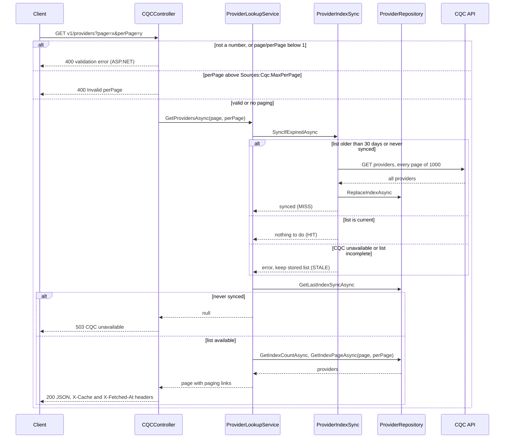
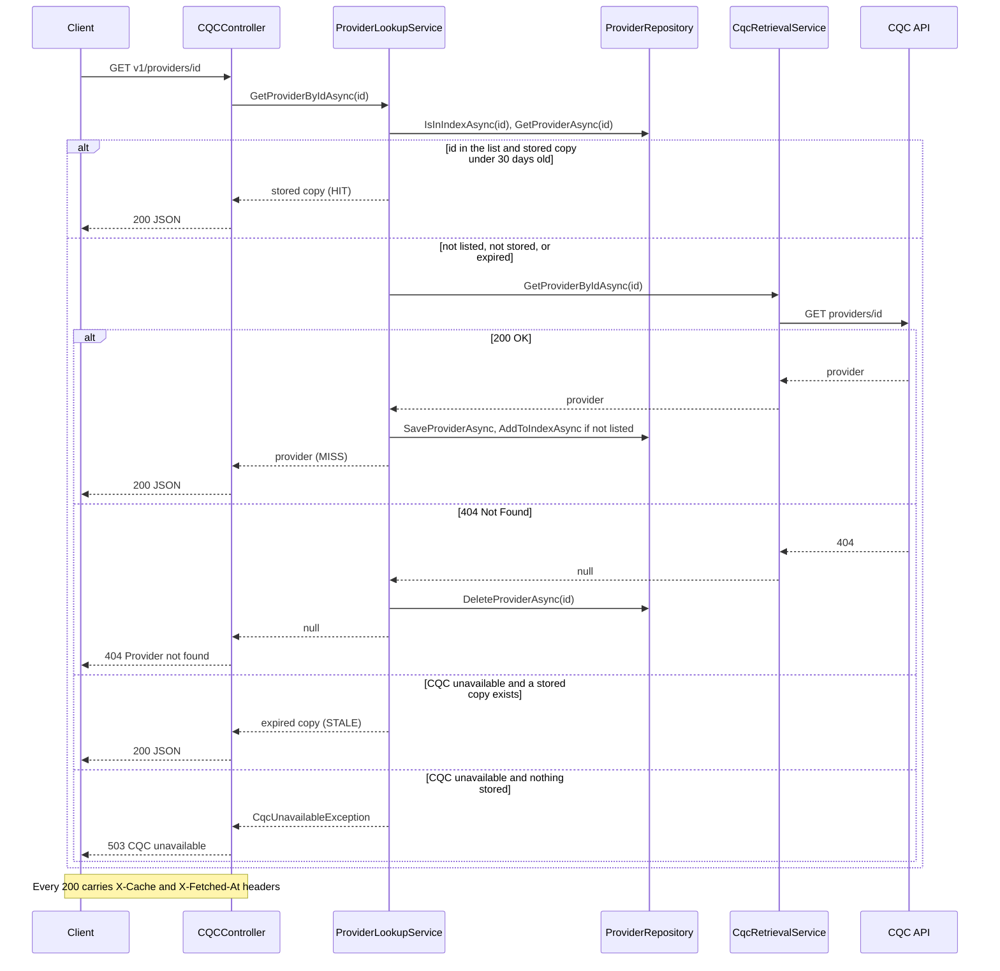
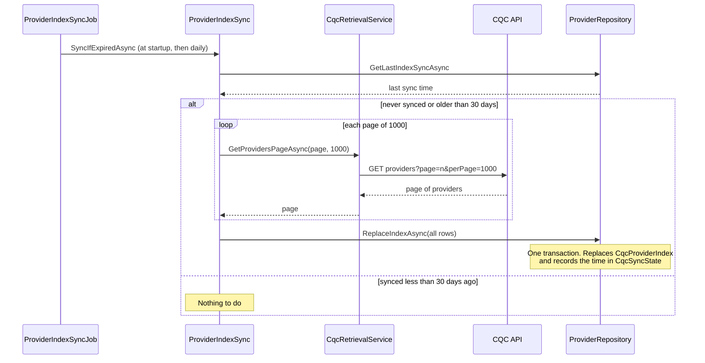
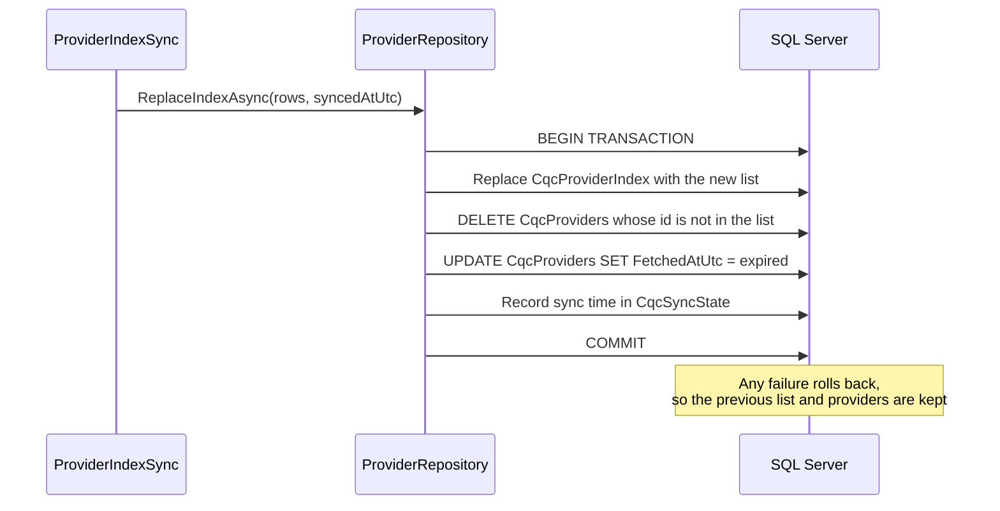

# Schemeserve Tech Test - .Net

## Introduction
The test covers the requirements as specified in `docs/NetCodingChallenge.md`.

Personally, I would have written this as one generic proxy/cache service that can sit in front of any external provider, not just CQC. The provider is chosen by an id/slug in the URL (e.g. `v1/{source}/providers` and `v1/{source}/providers/{id}`, or `https://{slug}.sc-proxy.internal/v1/providers`), and each provider's base URL, keys, expiry and the mapping from its JSON payload to Schemeserve's internal schema live in external configuration files. Adding a new source then means adding configuration, not code. Together with in-memory reads and regular syncs, this is a stronger and more versatile design. Although I considered this approach, I deliberately didn't implemented it because it is out of scope and I don't have enough information. Schema mapping(external to internal) could have then been constructed via a CLI tool for review before importing, or via a browser UI interface. 20 internally managed proxies/caches would become 1 interface.

### Unknowns for generic proxy/cache
* Authentication types.
* Upstream API calls.
* How upstream response data relates.
* How it is mapped internally.
* How it is obtained from the cache internally, and how the data relates to each other.

<b>Thank you for the opportunity to illustrate my creative and problem-solving capabilities.</b>

## Disclosure
* Some code portions are co-authored with an AI agent. Stack Overflow is dead ;)
* I stand over this design decision and its implementation. 

## Assumptions
* One month means 30 days
* A stored provider can be refreshed sooner than one month. Each monthly sync of the providers list also expires every stored provider, so the next request fetches it again from CQC. This keeps the stored copies in step with CQC's master list.
* If CQC is unreachable and an expired copy exists, expired copy is returned (see sequence diagrams below).
* Exposed API is an internal tool (not for public consumption)
	* No end-point authentication
	* No rate-limiting/throttelling
* Not-found ID's are not stored
* The Provider ID format will never change
* Data remains unchanged in database until they expire
* No "force update" requirement stated in test
* No audit logging (not a stated requirement).
* Logs go to the console and Visual Studio's output window, and on Windows also to the Application event log (warnings and errors only). There are no log files or central log store.
* End-points tested locally via Postman.
* Maximum page size is set by `Sources:Cqc:MaxPerPage` in appsettings.json (1000, CQC's own page size).
* No database migrations. The tables are created at startup if they don't exist, but existing tables are never changed. The database is only a cache of CQC data, so after a schema change, delete the CqcCache database and restart the API to recreate and refill it.
* No Schemeserve internal meta data is required, that maps to a specific provider entry.

### What I could have done
I am aware that .NET has advanced leaps-and-bounds since I last actively used it, and there are most likely more elegant .NET solutions I am not aware of. Quick research revealed some, such as Riok.Mapperly, which generates mapping code at compile time instead of it being written by hand (see `CqcProviderRow.FromProvider` / `CqcProviderRow.ToProvider`).

I deliberately designed the project, as is, in classic C# because I am not yet familiar enough with the newer .NET features and third-party packages to explain every line with confidence. Possible options are:
* **Generated mapping code:** a library such as Riok.Mapperly could write the code that copies a provider into a database row and back, instead of me writing it by hand.
* **Shorter class definitions:** newer C# lets you declare a class and its constructor in one line, which would remove a lot of repetitive setup code in the services and data classes.
* **One shared caching routine:** both endpoints follow the same "check the database, otherwise ask CQC, then store it" steps. That could be written once and reused, instead of each endpoint having its own version.
* **Automatic cache headers:** the `X-Cache` and `X-Fetched-At` headers could be added automatically to every response, instead of the controller adding them itself.
* **A replaceable clock:** the code reads the current time directly. Reading it through a small service instead would let tests set the exact time they need.
* **Shorter checks:** newer C# syntax could make some of the null checks and the HIT/MISS/STALE decision more compact.
* **Built-in retries:** Microsoft's resilience package could retry failed CQC calls, time them out and pause calls while CQC is down, with a few lines of setup instead of hand-written error handling.
* **Reading from memory:** frequently requested records could be kept in memory and refreshed regularly, so most requests never touch the database. The database would still be the permanent copy that survives a restart.
* **Storing records as JSON:** in a design that serves several providers, each record could be stored as the JSON CQC returns rather than one column per field, so any provider's data fits the same table. SQL Server handles this well. A document database such as MongoDB would only be worth it if the stored data needed to be searched or reported on in depth.
* **Stopping abandoned work:** if a caller gives up on a request, its database queries could be cancelled too, not just the call to CQC.
* **A status page:** a small internal page, on its own port (say 8080), showing the cache's state, whether CQC is reachable, and a way to test or manage the API key.
* **Health API end-point** that provdes summary for API, API version and commit info, and data health in general. This can by used by a more dedicated monitoring implementation (Prometheus/Grafana).
* **Alerts and triggers** notifications via email/Slack/Telegram of any critical issues.

## appsettings.json
```
"Sources": {
    "Cqc": {
      "BaseUrl": "https://api.service.cqc.org.uk/public/v1/",
      "SubscriptionKey": "65907e17e06440f6b212ded670f54cbb",
      "CacheTtl": "30.00:00:00",
      "MaxPerPage": 1000
    }
  },
```
Settings are grouped per external source under `Sources`. Only CQC exists today, but another provider could be added later with its own section (as mentioned in the introduction).


## Getting started

### Prerequisites
* .NET 10 SDK
* SQL Server LocalDB (installed with Visual Studio). To use another SQL Server, change `ConnectionStrings:CqcCache` in `appsettings.json`.

The `CqcCache` database and its tables are created automatically on first start.

### Run the API
* **Visual Studio:** open `SchemeserveDotnetTest.slnx`, choose the `http` profile and press F5.
* **Command line:** from the project folder, run `dotnet run --launch-profile http`.

The API listens on `http://localhost:5191`. On first start the background job downloads the full providers list from CQC (about 65 pages), so the first `GET v1/providers` can take a little while.

### Test the end-points
`SchemeserveDotnetTest.http` in the project folder holds ready-made requests. In Visual Studio, open it and click **Send request** above each one. The cache state of each response is in the `X-Cache` (HIT, MISS or STALE) and `X-Fetched-At` headers.

Or from a terminal:
```
curl -i "http://localhost:5191/v1/providers?page=1&perPage=10"
curl -i http://localhost:5191/v1/providers/1-10000227676
```

## Unit tests and code coverage
The tests are in the `SchemeserveDotnetTest.Tests` project (xUnit + Moq). They don't need SQL Server or the CQC API: the database, CQC and the list sync are replaced with mocks. `ICqcRetrievalService` and `IProviderIndexSync` exist for this reason.

What is covered:
* `ProviderLookupService`: HIT, MISS, STALE, ids not in the list, CQC 404, full list and paging (including only `page` or only `perPage` given).
* `ProviderIndexSync`: when a sync runs, that every CQC page is read, and that a failed or incomplete sync leaves the stored list alone.
* `CQCController`: 404s, `perPage` over the configured maximum (400) and exactly at it (200), 503s when CQC is down and nothing is stored, and the response headers: `X-Cache` (HIT, MISS and STALE each tested) and `X-Fetched-At` (exact value checked), for both endpoints. A 404 carries neither header.
* Paging values (`CQCControllerPagingTests`, "soft" tests): non-numeric `page` / `perPage` (e.g. `perPage=AJJJ`) are rejected by ASP.NET's own binder, and the `[Range]` attributes reject values below 1. These run the binder and attributes directly against the real `GetProviders` parameters.
* `CqcRetrievalService`: how CQC's 200, 404 and 500 responses, malformed JSON and a provider with the wrong id are handled (using a fake HTTP handler).
* `CqcProviderRow.FromProvider` / `ToProvider`: provider to database row and back.

Not covered by unit tests: `ProviderRepository`, `SchemaBootstrapper`, `SqlConnectionFactory`, `CqcSyncStateRow`, `ProviderIndexSyncJob` and `Program`. They need a real SQL Server or the running app, so they are marked `[ExcludeFromCodeCoverage]` (with a comment saying why). The repository has its own integration tests, skipped by default (see "Integration tests" below).

### Run the tests
* **Visual Studio:** Test > Run All Tests (Test Explorer).
* **Command line:** from the solution folder, run `dotnet test`.

### Code coverage report
From the solution folder:
```
dotnet test --settings SchemeserveDotnetTest.Tests/coverage.runsettings --collect:"XPlat Code Coverage"
dotnet tool install -g dotnet-reportgenerator-globaltool
reportgenerator -reports:"SchemeserveDotnetTest.Tests/TestResults/*/coverage.cobertura.xml" -targetdir:coverage -reporttypes:Html
```
The first command runs the tests and collects coverage (coverlet). The second installs ReportGenerator (only needed once). The third turns the result into an HTML report; open `coverage/index.html`.

50 unit tests (plus 7 integration tests, skipped by default), ~97.3% line coverage and ~96.5% branch coverage of the code in scope.

**Not included: end-to-end HTTP tests.** No test sends a real HTTP request through the whole app (e.g. with `WebApplicationFactory`). So, for example, the final 400 response for `?page=4&perPage=AJJJ` is not tested end to end; the paging tests above check the two pieces that produce it.

### Integration tests (skipped by default)
`SchemeserveDotnetTest.Tests/ProviderRepositoryIntegrationTests.cs` holds 7 integration tests for `ProviderRepository`: the real Dapper SQL against a real SQL Server database. They cover saving, updating, reading and deleting a provider; adding to, counting and paging the providers list; and the monthly list refresh (`ReplaceIndexAsync`), which deletes providers no longer listed, expires the rest and records the sync time.

They are **skipped by default**, because they need SQL Server. With the skip in place, Test Explorer and `dotnet test` show them as "Skipped" (7) next to the passing unit tests.

**What they need**
* SQL Server LocalDB on Windows (installed with Visual Studio; it is the same instance the API uses, `(localdb)\MSSQLLocalDB`).
* Nothing else. They do **not** need the API to have been run, the `.http` requests to have been sent, or any data from CQC. They make no calls to CQC.

**What they touch**
* Only a separate database, `CqcCache_IntegrationTests`, which the tests create on first run. The tables in it are emptied before every test.
* The API's own `CqcCache` database is never used, so your local data is safe.

**How to run them**
1. Open `SchemeserveDotnetTest.Tests/ProviderRepositoryIntegrationTests.cs`.
2. Change the `SkipReason` line to:
   ```csharp
   private const string? SkipReason = null;
   ```
3. Run the tests: Test Explorer > Run All, or `dotnet test` from the solution folder. To run only the integration tests:
   ```
   dotnet test --filter "FullyQualifiedName~IntegrationTests"
   ```
4. Put the `SkipReason` text back before committing, so the tests stay skipped on machines without SQL Server.

If SQL Server is not at `(localdb)\MSSQLLocalDB`, change the `ConnectionString` constant in the same file (keep `Database=CqcCache_IntegrationTests`). To remove the test database afterwards, run `DROP DATABASE CqcCache_IntegrationTests` against LocalDB (e.g. in SQL Server Object Explorer).

They are not part of the coverage figures above: the repository is marked `[ExcludeFromCodeCoverage]`, and the figures are measured with the integration tests skipped.

### Coverage figures: report vs Visual Studio
| Measured with | What is measured | Result |
|---|---|---|
| coverlet + ReportGenerator (commands above) | Code the unit tests are meant to reach | ~97.3% lines, ~96.5% branches |
| Visual Studio, Test > Analyze Code Coverage, before the exclusions were added | The whole project | ~35% lines, ~52.2% blocks |

Why the two differed:
* **Different scope.** Visual Studio measured every class in the project, including the ones unit tests cannot reach: the Dapper repository, the schema bootstrapper and the connection factory (all need SQL Server), the background job and the app startup (need the running app), and code the compiler generates for OpenAPI. Those lines can never run in a unit test, so they pulled the figure down.
* **Different tools.** Visual Studio uses Microsoft's own coverage engine and ignores `coverage.runsettings`, which only coverlet reads. Visual Studio also reports *blocks* (chunks of compiled code) rather than branches, so its numbers are not directly comparable even for the same scope.

The unreachable classes are now marked `[ExcludeFromCodeCoverage]` in the code, which both tools honour, so Visual Studio measures (almost) the same scope as the report. Any small remaining gap comes from generated code, which `coverage.runsettings` excludes for coverlet only, and from the different counting method.


## API endpoints

### GET v1/providers
Returns the providers list from the local database. With no parameters it returns the full list as one page. With `page` and/or `perPage` it returns CQC-style pages (`perPage` defaults to `Sources:Cqc:MaxPerPage` and may not exceed it). Values that are not whole numbers or are below 1 get a 400 from ASP.NET before the controller runs; a `perPage` above `Sources:Cqc:MaxPerPage` gets a 400 from the controller.


*(Mermaid diagram) Request flow for the providers list.*

### GET v1/providers/[id]
Returns a single provider. The id must look like `1-123456789`; anything else does not match the route and returns 404.


*(Mermaid diagram) Request flow for a single provider.*

## Error handling
* **CQC problems** (unreachable, error status, timeout, malformed JSON, a provider with a different id, an incomplete providers list) are all turned into one `CqcUnavailableException` in `CqcRetrievalService` / `ProviderIndexSync`.
* If an expired copy is stored, it is served with `X-Cache: STALE`. If nothing is stored, the API returns **503 CQC unavailable** (a ProblemDetails body).
* A failed database write while storing a provider is logged, and the provider is still returned.
* Anything else that isn't caught becomes a **500** ProblemDetails response (`AddProblemDetails` + `UseExceptionHandler` in `Program.cs`).
* If the database can't be created at startup, the app logs a hint (LocalDB installed and running, connection string correct) and stops.
* Any other error that stops the API (at startup or while running) is caught by a global try/catch in `Program.Main`, logged as critical, and the process exits with code 1.
* If logging itself fails (in `Program.Main` or where `CqcUnavailableException` is caught in `ProviderLookupService`), the error is written straight to the Windows Application event log instead (`Logging/EventLogFallback.cs`).

## Data health/sync
* **Full providers list, refreshed monthly:** a background job (`Jobs/ProviderIndexSyncJob.cs`) runs at startup and then checks once a day. When the stored list is older than 30 days, it pages through CQC's complete providers list and replaces the `CqcProviderIndex` table in a single transaction, so a failed sync keeps the previous copy. `GET v1/providers` is served from this table.


*(Mermaid diagram) Monthly refresh of the full providers list.*

* **Children refreshed with the list:** in the same transaction, any stored provider (`CqcProviders`) whose id is no longer in CQC's list is deleted, and every remaining stored provider is **<u>marked as expired</u>**. The first request for each provider after a list refresh therefore fetches it fresh from CQC and stores it again. The expired copy is kept only as a fallback if CQC is unreachable at that moment, and is marked as stale.


*(Mermaid diagram) What happens to stored providers when the list is refreshed.*

* **Provider ids validated against the list:** `GET v1/providers/{id}` only serves a stored copy if the id is in the providers list. Otherwise CQC is asked directly. A provider CQC added since the last sync is stored and added to the list, and an id CQC no longer knows (404) is removed locally. See the single provider diagram under API endpoints.

